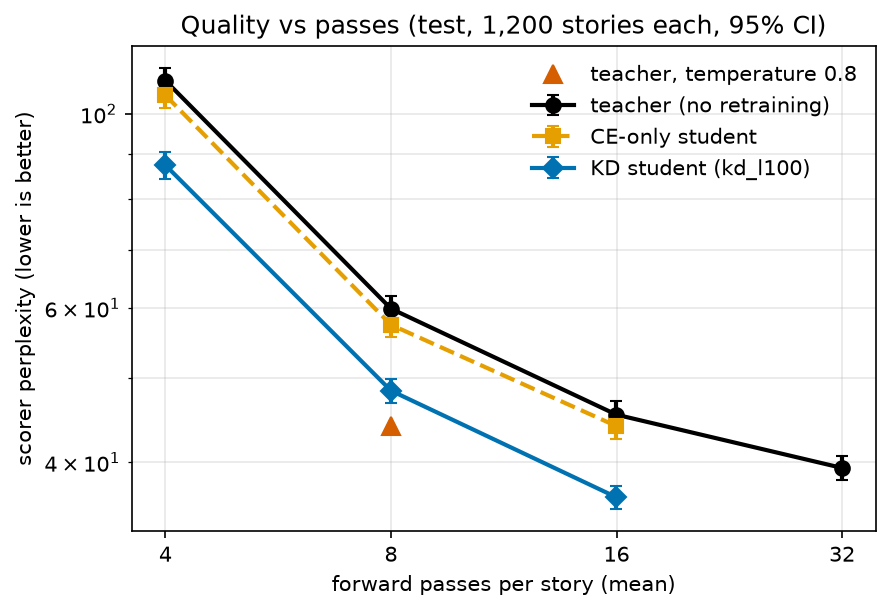
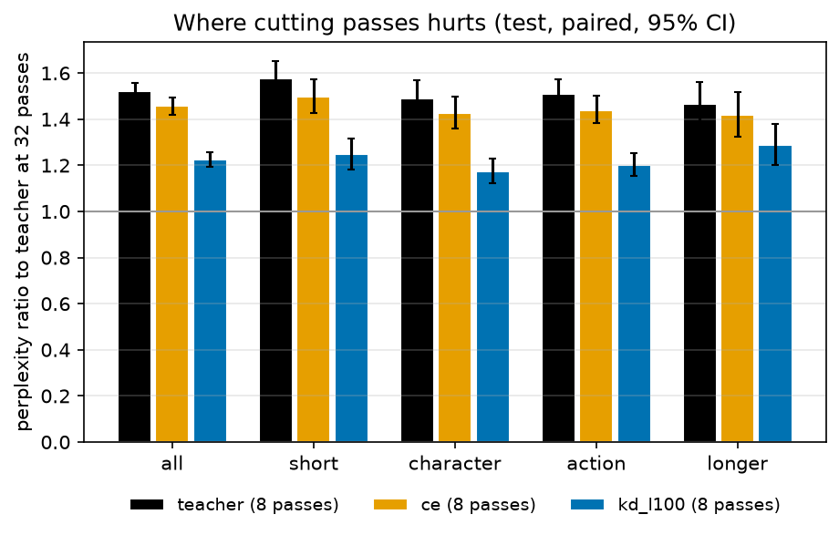
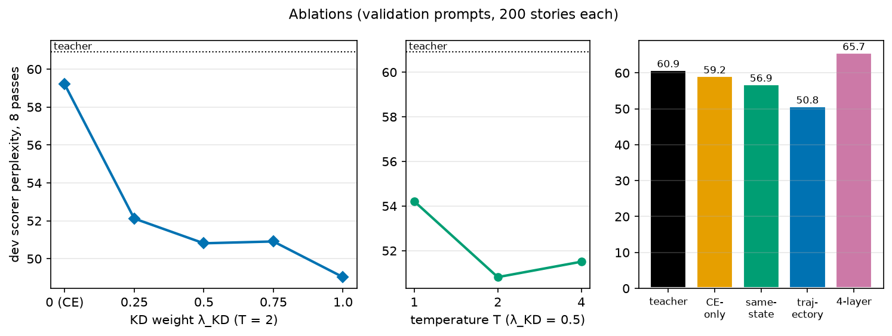
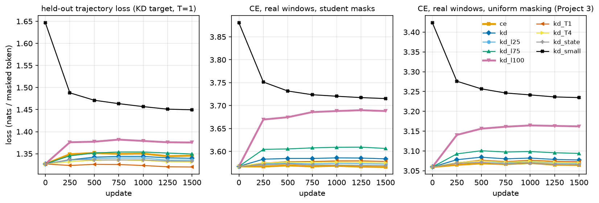
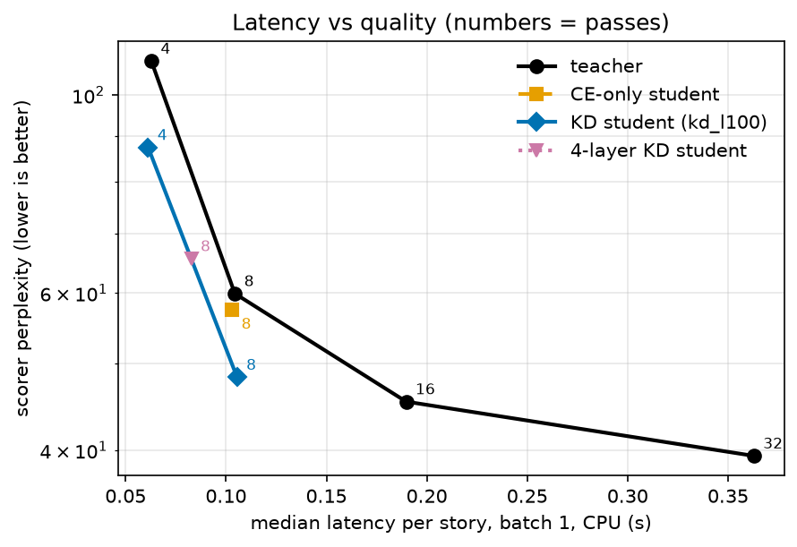
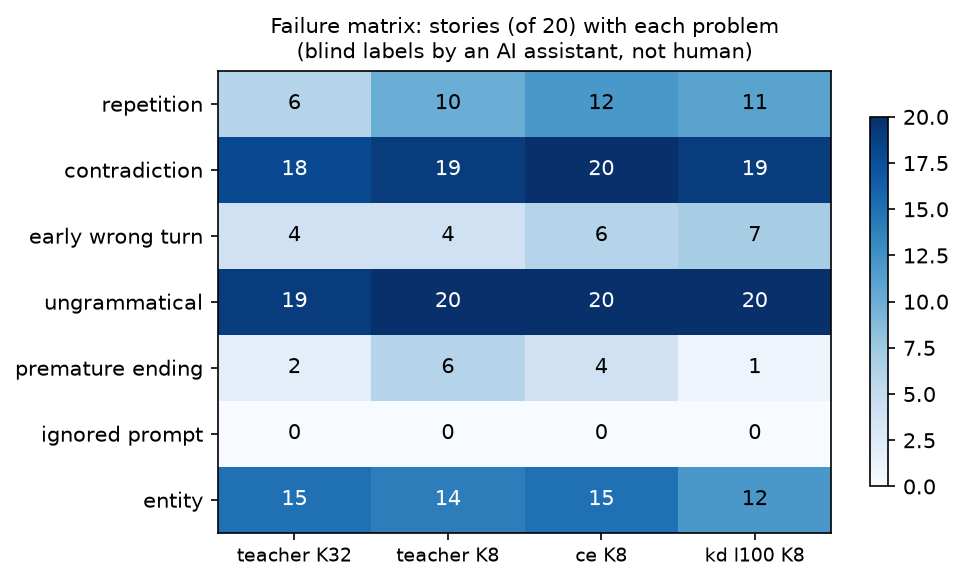

# Distillation of Diffusion Language Models

Project 7 of a series on small language models trained on TinyStories. It takes the masked diffusion language model of
Project 3 (MDLM-13.9M, the **teacher**, frozen) and trains a **student** that writes a story in fewer forward passes
(4, 8 or 16 instead of 32), by learning from the teacher's own denoising trajectories. Decoding uses Project 6's best
decoder (random order + no-adjacent, early stop, lazy token drawing) for every system.

**Research question:** can a diffusion language model be distilled so that it needs fewer denoising steps while keeping
the quality of the slow teacher?

**Short answer:** partly, and mostly through sharpening. A same-size student, fine-tuned for 1,500 updates (~26 min on
a CPU) on teacher trajectory targets, writes stories at **8 passes as well as the teacher does at 16** (perplexity ratio
1.065 [1.034, 1.097]) and is **20% better than the teacher at 8 passes**, at a **3.44× speed-up** over the 32-pass
teacher. The teacher's supervision helps beyond extra training on real text (−16% vs a CE-only student). But the
student is also **less varied** (Distinct-2 −0.06), and simply sampling the teacher at **temperature 0.8** gives *lower*
perplexity (44.0 vs 48.3) with *more* variety, with no training at all. Most of the measured gain is a more confident
distribution, not better story logic.



## Results (400 test prompts × 3 seeds = 1,200 stories per system)

| System | Passes | Median latency | Scorer perplexity [95% CI] | Distinct-2 | Repetitive |
|---|---|---|---|---|---|
| real continuations | – | – | 4.5 [4.2, 4.9] | 0.541 | 6.2% |
| teacher | 32 | 363 ms | 39.4 [38.2, 40.7] | 0.430 | 1.8% |
| teacher | 16 | 190 ms | 45.3 [43.7, 47.0] | 0.437 | 1.0% |
| teacher | 8 | 104 ms | 59.9 [57.9, 62.0] | 0.441 | 0.5% |
| teacher | 4 | 63 ms | 109.1 [105.5, 112.8] | 0.453 | 0.2% |
| teacher, temperature 0.8 | 8 | – | 44.0 [42.5, 45.4] | 0.402 | 2.7% |
| CE-only student | 8 | 103 ms | 57.4 [55.6, 59.3] | 0.426 | 0.2% |
| **KD student (kd_l100)** | 16 | – | **36.5** [35.4, 37.6] | 0.370 | 5.1% |
| **KD student (kd_l100)** | 8 | 106 ms | **48.3** [46.7, 49.9] | 0.383 | 2.8% |
| **KD student (kd_l100)** | 4 | 61 ms | **87.4** [84.4, 90.4] | 0.395 | 0.8% |
| KD student, same-state targets | 8 | – | 56.3 [54.4, 58.2] | 0.419 | 0.6% |
| KD student, 4 layers | 8 | 83 ms | 65.6 [63.3, 67.9] | 0.380 | 1.5% |
| teacher, confidence order | 7.4 | – | 3351 | 0.411 | 0.0% |

Scorer perplexity = how surprising an independent model (TinyStories-33M) finds the story; lower is better. Latency:
batch 1, CPU, fp32, 24 threads. Full tables, paired tests and hypothesis verdicts are in `INSTRUCTIONS.md`, Phases 12–15.

### What we learned
1. **Cutting passes without retraining is expensive.** Teacher 32 → 8 passes: perplexity ×1.52; 32 → 4: ×2.77.

   

   *Perplexity at 8 passes relative to the teacher at 32, per prompt type. The KD student (blue) loses far less than
   the teacher or the CE-only student, for every kind of prompt.*
2. **Trajectory targets work; same-state targets barely do.** A student that starts as a copy of the teacher gets
   almost no signal from the teacher's distribution *at the same state* (it already predicts exactly that). Teaching
   it what the teacher did *during and after* the next span of passes is what helps (0.890 [0.872, 0.907] vs
   same-state targets).
3. **More teacher, lower perplexity, less variety.** λ_KD from 0 to 1 lowers dev perplexity from 59.2 to 49.0 and
   Distinct-2 from 0.516 to 0.467. T = 2 is best. The best run uses **no real-text loss at all** (λ_KD = 1).

   

   *Validation perplexity at 8 passes. Left: more weight on the teacher keeps helping. Middle: temperature 2 is best.
   Right: trajectory targets beat same-state targets and CE-only training; a 4-layer student is worse than the teacher.*
4. **H8 failed: distillation here is mostly sharpening.** At 8 passes, temperature 0.8 on the untouched teacher beats
   the best student (ratio 1.098 [1.074, 1.122]) with more variety. The student also got *worse* at predicting real
   hidden words (masked CE 3.53 → 3.64): it moved toward the teacher's predictable style.

   

   *Left: the KD loss on held-out teacher trajectories. Middle and right: cross-entropy on real masked words; the best
   student (kd_l100, pink) gets worse at real text while it learns to imitate the teacher.*
5. **Speed is just pass count.** A student pass costs the same as a teacher pass; 8 passes are 3.44× faster than 32
   (86% of the ideal 4×). A 4-layer student is another 1.28× faster but worse than the untouched teacher.

   
6. **Blind error review (AI labels, not human; 80 stories):** rubric 2.33 / 5 for the 32-pass teacher, 1.90 at 8 passes,
   1.97 for the KD student at 8. The student ends stories properly more often (1 vs 6 premature endings in 20) but does
   not fix coherence or grammar.

   

## Repository

```
distill/             the code
  prompts.py         test/dev prompts (from Project 6, hash-checked) + 6,300 training prompts (training split)
  models.py          frozen teacher; student = copy of the teacher (optionally fewer layers)
  trajectories.py    teacher 32-pass trajectories: final token + pass at which each position was fixed
  states.py          training states: trajectory states (state, span, rest) and real masked windows
  losses.py          KL(teacher || student) with temperature, CE, mixing
  train_student.py   the training loop, validation every 250 updates
  run.py             generate + score + summarise (dev, test)
  select.py          the selection rule on dev -> kd_best and the test systems
  compare.py         paired bootstrap tests, one per hypothesis
  recon.py           masked-token reconstruction on real test windows
  benchmark.py       latency, throughput vs batch, memory
  errors.py          blind error-analysis sample, counts, divergence per prompt group
  plots.py           figures
configs/             9 training runs, decoders, selection rule and hypotheses, written before training
scripts/             train_all.sh, stage2.sh, bench.sh, check_reproduce.py
results/             trajectories, training logs, generations, scores, summaries, benchmarks, error labels, figures
tests/               27 tests
```
Checkpoints (`checkpoints/<run>/student.pt`, 54 MB each) are not committed; `scripts/train_all.sh` rebuilds them.

## Reproduce

Windows, Python 3.12, CPU (~7 h in total). The teacher, decoder, scorer and evaluation code are read from the sibling
folders `../project1` … `../project6` (imported read-only).

```
python -m venv .venv
.venv\Scripts\activate
pip install torch==2.14.1 --index-url https://download.pytorch.org/whl/cpu
pip install -r requirements.txt
python -m pytest -q
python -m distill.prompts
python -m distill.trajectories                    # ~30 min
bash scripts/train_all.sh                         # 9 runs, ~3.3 h
python -m distill.run --split dev                 # ~1 h
python -m distill.recon
python -m distill.select
python -m distill.run --split test                # ~45 min
python -m distill.compare
bash scripts/bench.sh                             # quiet machine, ~15 min
python -m distill.errors --stage sample           # then label blind, then:
python -m distill.errors --stage count
python -m distill.errors --stage divergence
python -m distill.plots
```

`INSTRUCTIONS.md` walks through all 16 phases with the reasons for each choice.

## Limits
CPU only, one small model (13.9M parameters), one domain (TinyStories), short fine-tuning (1,500 updates, one seed per
run). Quality is judged by an automatic scorer that prefers predictable text, which favours sharper models; that is
why the temperature-0.8 baseline matters. Distinct-2 depends on how many stories are pooled (dev 50, test 100 per
cell), so the 0.40 acceptability rule is stricter on test: the KD student at 4 passes passes it on dev (0.496) but not on
test (0.395). The error analysis uses labels from one AI annotator (not humans) on 20 stories per system. A learning
rate of 1e-4 was tried first and made held-out loss worse; all runs use 3e-5 (pilot kept in `results/metrics/train_pilot`).
